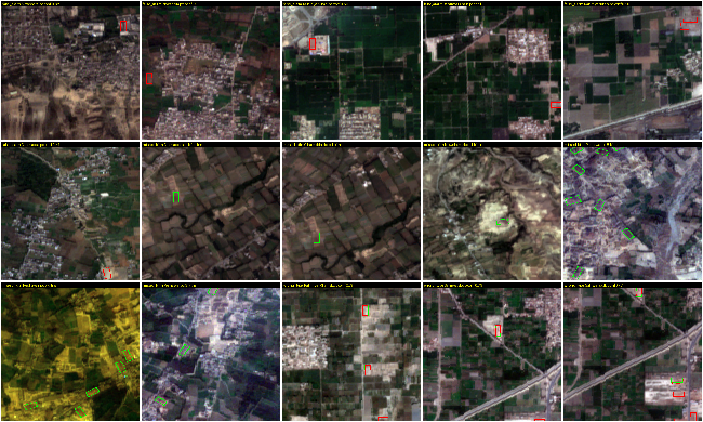

# Failure gallery

Final model `yolov8s_384_urban`, box threshold 0.20 (chosen on validation). Green boxes are labels, red boxes are model predictions. Patches are 128 x 128 pixels at 10 m, drawn 3 times larger. Made by `src/09_failure_gallery.py`. The full list of failures is in `failures/candidates.csv`.

## How often each kind happens on the test sets

| Kind | Peshawar valley test | Punjab test |
|---|---|---|
| False alarm on an empty patch | 23 of 521 empty patches (10 of them in 200 urban patches) | 37 of 829 empty patches |
| Kiln patch with no detection | 81 of 642 kiln patches (19 in SentinelKilnDB images, 62 in our re-cut images of the same kilns) | not drawn |
| Zigzag kiln typed as FCBK | KP has no Zigzag kilns in the data | 280 of 321 patches with a Zigzag kiln |

## The 15 examples and why they fail

| # | File | Kind | Where | Why we think it fails |
|---|---|---|---|---|
| 0 | `failures/false_alarm_00.png` | false alarm (urban) | Nowshera | A bright rectangular building at the edge of a town. A fired kiln is also a bright rectangle about 10 by 3 pixels, so large sheds and factory roofs look the same at 10 m. |
| 1 | `failures/false_alarm_01.png` | false alarm (urban) | Nowshera | A long narrow plot on the edge of a village. Plot shape and size match a kiln, and there is no chimney or smoke to see at this resolution. |
| 2 | `failures/false_alarm_02.png` | false alarm (urban) | Rahim Yar Khan | A walled rectangular compound with a bright yard, probably a school, factory or depot. |
| 3 | `failures/false_alarm_03.png` | false alarm | Rahim Yar Khan | A bright strip on a field boundary at the patch edge, cut off so its full shape is not visible. |
| 4 | `failures/false_alarm_04.png` | false alarm | Rahim Yar Khan | Two long bright sheds side by side, the shape of poultry farms. This matches the plan's expected failure "factories, poultry farms or rooftops". |
| 5 | `failures/false_alarm_05.png` | false alarm | Charsadda | An elongated plot at the edge of a village, the same pattern as #1. |
| 6 | `failures/missed_kiln_06.png` | missed kiln | Charsadda | The labelled kiln is barely visible among fields. It may have been inactive or abandoned when the image was taken, so it has no burnt ring or bright brick stacks. |
| 7 | `failures/missed_kiln_07.png` | missed kiln | Charsadda | The same kiln as #6 in the next, overlapping patch. Both patches miss it, so the cause is the kiln's appearance, not its position in the patch. |
| 8 | `failures/missed_kiln_08.png` | missed kiln | Nowshera | A kiln inside a large bright bare area. Each patch is stretched by its own darkest and brightest pixels, so the kiln has almost no contrast with the bare ground around it. |
| 9 | `failures/missed_kiln_09.png` | missed kiln (8 kilns) | Peshawar | A dense cluster of 8 kilns in a hazy winter image. The haze washes out the contrast. The same patch from the dataset's own image is detected, which points to haze, not the kilns. |
| 10 | `failures/missed_kiln_10.png` | missed kiln (5 kilns) | Peshawar | A strong yellow colour cast. The per-patch stretch is set by the darkest and brightest pixel of each band, so one unusual pixel can shift the whole patch's colours. |
| 11 | `failures/missed_kiln_11.png` | missed kiln (3 kilns) | Peshawar | Hazy image with kilns in mixed village and field land, low contrast. |
| 12 | `failures/wrong_type_12.png` | wrong type | Rahim Yar Khan | A Zigzag kiln found in the right place but typed FCBK. At 10 m both types are bright rectangles of similar size; the zigzag firing pattern inside is smaller than a pixel. |
| 13 | `failures/wrong_type_13.png` | wrong type | Sahiwal | Same as #12. |
| 14 | `failures/wrong_type_14.png` | wrong type | Sahiwal | Same as #12. Next to the kiln are bright sheds that the model also marks (a false alarm of the #4 kind). |

## What this means for an inspector

- False alarms are buildings and plots with the size and shape of a kiln. Tier 2 of the priority list (new detections) says "verify on high-res imagery first" for this reason.
- Haze is the biggest cause of missed kilns. Our re-cut images come from the November to February smog season and miss three times as many kiln patches as the dataset's own images of the same kilns (62 against 19). That is exactly the season when inspections matter most.
- The kiln type is not reliable. Most Zigzag kilns are called FCBK, so a kiln listed as FCBK could still be a cleaner Zigzag kiln. The priority score weighs FCBK twice as high as Zigzag, so a misread Zigzag kiln would be ranked too high, never too low.
